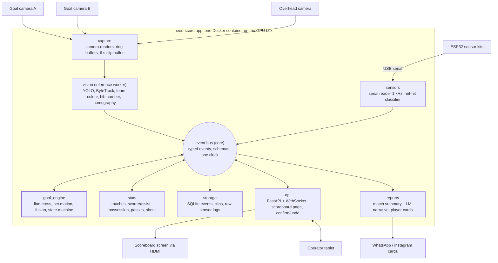

# Neon Football Auto-Scoring Module — Build Plan

_Last updated: 6 Oct 2026_

## Goals and scope

v1 replaces manual goal entry for one 3v3 neon cage: detect every goal automatically, name the scorer, and push the score to the scoreboard. Target: at least 97% of goals auto-detected, under 1 false goal per hour, score updated within 1 second.

**Venue facts (confirmed):** 15 m × 10 m enclosed cage, 3 v 3, no goalkeeper, recording for training approved by the owner. The existing scoreboard's control method is unknown, so v1 ships its own scoreboard API and display page.

**In v1**

- Goal detection from goal cameras plus net sensors, fused
- Scorer, assist and own-goal attribution
- Operator tablet to confirm low-confidence goals and correct mistakes
- Per-match event log (JSON) and a simple match report

**Later (v2+)**

- Possession, passes, shots, heatmaps from an overhead camera
- Player profiles across matches, leaderboards
- LLM-generated match summaries and WhatsApp/Instagram cards
- Multi-cage support and highlight clips

## Monolithic architecture

Ship one modular monolith: a single Python app in one Docker container per cage, split into modules that share nothing but the event bus. Deployment stays one process on one box, while each module can be tested alone and swapped later.



The goal engine (highlighted) is the v1 core; stats and reports grow on the same events later.

**Rules that keep the monolith clean**

- Modules import only `core` (bus, schemas, clock), never each other.
- Every message is a typed pydantic event stamped by the shared clock. Storage subscribes to everything, so any match can be replayed.
- Heavy work runs in worker processes inside the app: one inference process for the GPU, one capture thread per camera. Everything else is threads on the bus.
- All venue settings (camera URLs, ROIs, goal lines, thresholds) live in one `cage.yaml`, set with the ROI calibration tool.
- If you outgrow one box, the bus is the seam: swap the in-process queue for Redis or NATS and move a module out without rewriting it.

**Latency budget for a goal:** capture 10–20 ms, inference about 8 ms, fusion window 300 ms, scoreboard push under 50 ms. Total stays well under 1 s.

## Hardware and sensors

One cage needs two goal cameras, one overhead camera, two ESP32 sensor kits and one GPU box. Prices are approximate Indian retail.

| Item | Qty | Spec | Approx. cost (INR) |
| --- | --- | --- | --- |
| Goal camera | 2 | 60–120 fps, global or fast rolling shutter, manual exposure, USB3 or PoE | 8,000–25,000 each |
| Overhead camera | 1 | Wide/fisheye, 30–60 fps, ceiling mount at centre | 5,000–15,000 |
| GPU box | 1 | Jetson Orin Nano/NX, or PC with RTX 3060+ | 45,000–90,000 |
| ESP32 dev board | 2 | One per goal | 500 each |
| Accelerometer (ADXL345) | 4 | Back net + frame, per goal | 300 each |
| IR break-beam pairs (optional) | 10–12 | 38 kHz modulated, 12–15 cm spacing | 150–300 each |
| Operator tablet | 1 | Any Android tablet | existing |

**Camera placement**

- **Overhead camera: yes, centre top is the best spot.** Mount it on the roof frame directly above the centre spot, lens pointing straight down. Use a pipe clamp or U-bolt bracket on a roof tube, a steel safety cable, and a small mesh guard so a high ball can't knock it.
- It must see 16 m × 11 m (pitch plus 0.5 m margin), which needs a wide or fisheye lens; see the table below. Undistort the fisheye image during calibration.
- Prefer 4K: about 240 px per metre, so the ball is about 50 px wide. 1080p gives about 120 px/m (ball about 26 px), still workable.
- If the roof is lower than 4 m, or the fisheye edges are too distorted, use two overhead cameras, each above the centre of one half.
- **Goal cameras:** on the cage frame at the top corner beside each goal, about 2.5–3 m high, looking down across the goal mouth. Press the lens against the mesh (within 2–3 cm) so the mesh blurs out of focus, or fit a lens-sized opening with a protective plate.
- Lock exposure, gain and white balance on all cameras. Use a fast shutter (1/500 s or faster) on goal cameras; add UV lighting near the goals if images get too dark.

| Roof height above floor | Lens field of view needed (long × short side) |
| --- | --- |
| 4 m | about 127° × 108° |
| 5 m | about 116° × 95° |
| 6 m | about 106° × 85° |

**Sensor kit per goal**

- One ADXL345 on the back net, one on the crossbar/frame, sampled at 1 kHz.
- ESP32 connected to the GPU box by USB serial (lowest latency, shared clock). Fall back to Wi-Fi + MQTT with NTP sync only if cabling is impossible.
- Sensors in hard plastic cases, cables routed inside the frame tubes, away from players.
- Firmware streams raw samples in v0 (for data collection), then on-device RMS events in v1.

## Fine-tuning plan

Four models are trained on footage from this venue only; public football datasets do not match UV lighting, neon bibs or cage mesh.

| Model | Base | Training data | Target metric |
| --- | --- | --- | --- |
| Ball + player detector | YOLO11n/s (or YOLOv8s), 1280 px input for goal cams | 1,500–3,000 labelled frames: ball, player, goal posts; at least 30% with blurred ball | Ball recall ≥ 0.90 in goal ROI; player mAP50 ≥ 0.95 |
| Jersey number reader | Small CNN classifier (0–99) on bib crops, or fine-tuned PARSeq | 3,000–5,000 bib crops, auto-cropped by the detector, labelled in a quick UI | Track-level number accuracy ≥ 98% after voting |
| Team classifier | No training: k-means on HSV of bib crop (orange vs green) | 50 crops to set thresholds | ≥ 99.5% |
| Net-hit classifier | Random forest on hand features, then 1D CNN | 0.5 s sensor windows labelled goal / post / wall / player / noise | Goal recall ≥ 0.98, false-positive rate ≤ 1% |

**Data collection (start now)**

1. Record 5–10 full matches from each fixed camera at full fps, saved raw (never through WhatsApp).
2. Log sensor data at the same time with the same clock.
3. Mark the true goals, post hits and wall hits by timestamp while recording (operator button) — this gives labels for free.

**Labelling**

- Tool: CVAT or Label Studio (self-hosted) or Roboflow.
- Bootstrap: label 300 frames by hand, train, then use the model to pre-label the next batch and only correct it.
- Sample frames heavily around goals and shots; random sampling wastes effort on idle play.

**Training tricks for this venue**

- Augment with motion blur, colour jitter towards blue/violet, and random mesh overlays.
- Train the ball class with smaller anchors / higher input resolution; consider SAHI tiling for the overhead view.
- Keep a fixed validation set of 3 matches never used in training; re-evaluate after every retrain.
- Export to TensorRT (FP16) for the GPU box; check per-frame latency stays under 8 ms on goal cams.

## Goal decision engine

A goal is declared only when two independent signals agree within a 300 ms window; one signal alone goes to the operator.

**Signals per goal**

- **V (vision line-cross):** consecutive ball positions form a segment that intersects the goal line between the posts, moving inward. Kalman prediction fills in when the ball is missed for up to 3 frames.
- **N (net motion):** frame-difference energy in the net ROI exceeds its rolling baseline by k×.
- **S (sensor):** net-hit classifier fires on the back-net accelerometer.
- **P (players in mouth):** a player box overlaps the goal mouth at the event time. With no goalkeeper this is uncommon, so it mostly flags a player running or falling into the net.

| Signals seen | Decision | Action |
| --- | --- | --- |
| V + (S or N) | Goal, high confidence | Auto-update scoreboard |
| S + N, no V | Goal, medium confidence | Show 3 s confirm prompt on tablet; auto-accept if no reject |
| V only | Possible goal | Tablet prompt, needs a tap |
| S only + P | Player in net | Reject, log |
| Frame sensor > net sensor | Post/bar hit | Log as shot on woodwork |

**No goalkeeper changes three things.** The goal mouth is usually empty, so the goal cameras rarely lose the ball behind a body near the line. Shots come from anywhere, including long range, so the shot-speed threshold must be tuned for hard, low shots. A defender blocking on the line (ball path stops before the line, no net signal) is logged as a block, not a save.

**State machine per match**

1. `IN_PLAY` → candidate event → `EVALUATING` (300 ms window).
2. `EVALUATING` → goal → `GOAL_LOCKED`: ignore new goals until the ball is seen back at the centre or 5 s pass.
3. `GOAL_LOCKED` → kick-off detected → `IN_PLAY`.
4. Operator can undo any goal at any time; undo writes a correction event, never deletes.

Every decision stores its signals, scores and a 6 s clip (3 s before, 3 s after). These clips are the review queue and the next round of training data.

## Scoreboard and match API

v1 owns the scoreboard: the GPU box serves a full-screen scoreboard page and sends it to the venue screen over HDMI (Chromium in kiosk mode), so nothing depends on the existing scoreboard's unknown software. If that scoreboard later turns out to have an API, a small adapter in `api/` forwards the same events to it.

REST for commands, one WebSocket for live updates; write endpoints need an API key and are reachable only on the venue LAN.

| Method | Path | Purpose |
| --- | --- | --- |
| POST | `/api/v1/matches` | Start a match: teams, players, bib numbers, duration |
| GET | `/api/v1/matches/current` | Score, clock, status, pending goals |
| POST | `/api/v1/matches/{id}/pause` · `/resume` · `/end` | Match clock control |
| POST | `/api/v1/matches/{id}/goals` | Manual goal by the operator |
| POST | `/api/v1/matches/{id}/goals/{goal_id}/confirm` | Accept a pending goal |
| POST | `/api/v1/matches/{id}/goals/{goal_id}/undo` | Reject or undo a goal (writes a correction event) |
| PATCH | `/api/v1/matches/{id}/goals/{goal_id}` | Change scorer, assist or own-goal flag |
| GET | `/api/v1/matches/{id}/events` | Full event log |
| GET | `/api/v1/matches/{id}/report` | Stats and LLM summary |
| WS | `/ws/matches/current` | Push: `score_update`, `goal_pending`, `goal_confirmed`, `goal_undone`, `clock_tick` |
| GET | `/scoreboard` · `/operator` | Display page · operator tablet page |

A goal event as sent on the WebSocket:

```json
{"type": "goal_confirmed", "match_id": "m_0412", "goal_id": "g_07",
 "t": "2026-10-12T19:42:13.482+05:30", "team": "orange", "scorer": 9, "assist": 10,
 "own_goal": false, "confidence": "high", "signals": ["V", "S", "N"],
 "score": {"orange": 4, "green": 3}, "clip": "/clips/m_0412/g_07.mp4"}
```

## Stats engine

All stats derive from one stream of touch events, computed in pitch coordinates (metres) via a homography from the overhead camera, calibrated on the four cage corners of the 15 m × 10 m pitch.

**Touch detection:** ball within 0.6 m of a player's feet point and ball velocity changes by more than a set angle or speed. The touch is assigned to the nearest tracked player (team + number).

| Stat | Rule |
| --- | --- |
| Scorer | Last touch before a confirmed goal |
| Assist | Previous touch by a different player of the same team, within 8 s |
| Own goal | Last touch by the defending team |
| Possession | Share of time each team holds the ball (last touch, ball in play) |
| Pass | Consecutive touches by two players of the same team |
| Interception | Consecutive touches by players of opposite teams |
| Shot | Ball speed > threshold heading into the goal-mouth cone after a touch |
| Shot on target | Shot whose predicted path crosses the goal line between posts |
| Distance covered | Sum of smoothed track displacement per player |
| Heatmap | 2D histogram of each player's pitch positions |

v1 needs only scorer, assist and own goal, which can run from the goal cameras alone (last player near the ball before the shot). The rest switches on with the overhead camera in phase 4.

## Phased roadmap

Five phases over roughly 18 weeks; manual scoring stays in place until the phase 2 shadow-mode gate is passed.

| Phase | Weeks (rough) | Work | Gate to pass |
| --- | --- | --- | --- |
| 0. Collect data | 1–3 | Fixed cameras + raw sensor logging, operator goal button; label 300 frames, train first YOLO, build replay runner | 10 matches recorded, 100+ goals labelled |
| 1. Offline goal engine | 3–6 | Line-cross + net motion on replay, ROI calibration tool; retrain YOLO with blurred-ball frames, TensorRT export | Replay goal recall ≥ 90%, under 2 false goals per hour |
| 2. Sensors + shadow mode | 6–9 | ESP32 kits installed, net-hit classifier, fusion rules; runs beside manual scoring with tablet confirm UI | **2 weeks shadow: recall ≥ 97%, under 1 false goal per hour** (go-live gate) |
| 3. Go live + scorer | 9–12 | Auto scoreboard, bib numbers, scorer / assist / own goal; undo and correction log, watchdog, manual fallback | Operator corrections under 5% of goals |
| 4. Full stats + reports | 12–18 | Overhead camera, possession, passes, shots, heatmaps; LLM match summaries and shareable player cards | — |

Start phase 0 this week: it needs only a tripod-mounted phone or one camera beside a goal, plus an operator pressing a button on each goal. Every later phase is judged on the replay runner against the labelled matches from this phase.

**First tasks**

- [ ] Put up the recording notice at the entry (owner has approved recording)
- [ ] Record 3 matches from a fixed 60 fps camera beside one goal
- [ ] Build the scoreboard API skeleton and its operator page; use its manual goal button as the goal logger
- [ ] Order 2 ESP32 boards and 4 ADXL345 sensors; start raw logging
- [ ] Set up the repo skeleton, core bus and schemas
- [ ] Label the first 300 frames and train YOLO v0

## Repository structure and tech stack

One Python repo, one deployable app, with folders as hard module boundaries; modules talk only through the event bus and shared schemas.

```
neon-score/
  app/
    main.py              # starts all workers, wires the bus
    config/              # cage.yaml: cameras, ROIs, goal lines, thresholds
  core/
    bus.py               # in-process pub/sub (queues), event types
    schemas.py           # pydantic models: Frame, Detection, Track, SensorEvent, Touch, Goal
    clock.py             # single monotonic clock, sensor offset correction
  modules/
    capture/             # camera readers (GStreamer/OpenCV), ring buffers
    sensors/             # serial reader, net-hit classifier
    vision/              # detector, tracker, team + number, homography
    goal_engine/         # line-cross, net motion, fusion, state machine
    stats/               # touches, scorer/assist, match stats
    storage/             # SQLite writer, clip saver
    api/                 # FastAPI + WebSocket: scoreboard, tablet UI
    reports/             # match summary, LLM narrative
  firmware/esp32/        # PlatformIO project for sensor kits
  training/
    datasets/  notebooks/  scripts/   # export, label sync, train, eval
  tools/                 # ROI calibration UI, replay runner
  tests/
    replay/              # recorded matches + expected goals
```

| Layer | Choice | Why |
| --- | --- | --- |
| Language | Python 3.11 | Fits your LLM stack; all CV libs available |
| Capture | OpenCV + GStreamer (NVDEC on Jetson) | Hardware decode, RTSP and USB |
| Detection | Ultralytics YOLO → TensorRT FP16 | Fast fine-tuning and export |
| Tracking | ByteTrack / BoT-SORT (via supervision or boxmot) | Proven, simple |
| Bus | Python queues + threads; multiprocessing for heavy inference | No broker to run |
| API/UI | FastAPI + WebSocket; small React or HTMX tablet page | Live score and confirm prompts |
| Storage | SQLite (events) + files (clips, raw sensor logs) | Zero ops, one file per venue |
| Firmware | ESP32 + PlatformIO (Arduino framework) | Cheap, quick |
| Training | Label Studio/CVAT, Ultralytics, PyTorch, scikit-learn | Standard |
| Deploy | Single Docker image + systemd, one per venue | Easy updates |

The most important test asset is the **replay runner**: it feeds recorded video and sensor logs through the full app faster than real time and compares goals against labels. Every change to thresholds or models is judged by this, not by watching live matches.

## Risks and open questions

| Risk | Impact | Mitigation |
| --- | --- | --- |
| UV light too dim for fast shutter | Blurred ball, missed line-crossings | Test cameras on site first; add UV floodlights over goals; rely on net/sensor fusion |
| Green ball looks like green bibs | False ball detections | Detector trained on venue data; colour backup only inside goal ROI with size filter |
| Sensors knocked loose or out of alignment | False or missed net hits | Hard cases, self-check before each match, alert if baseline drifts |
| Numbers unreadable (folded bibs, back turned) | Wrong scorer | Vote across the whole track; operator can reassign on tablet |
| Players swap bibs between matches | Wrong player profiles | Link number to player per match at sign-in, not permanently |
| GPU box overheats or crashes mid-match | No auto score | Watchdog restarts workers; scoreboard keeps manual mode as fallback |
| Venue Wi-Fi unreliable | Lost sensor events | USB serial for sensors; everything runs locally, cloud sync optional |

**Decisions so far**

| Question | Answer | Effect on the plan |
| --- | --- | --- |
| Goalkeeper? | None | Goal mouth usually clear; blocks logged instead of saves |
| Existing scoreboard control? | Unknown | Own scoreboard API + HDMI display page; adapter later if possible |
| Pitch size | 15 m × 10 m | Overhead field of view and homography set from this |
| Camera mounting | Cage frame; overhead at centre top | Roof clamp + safety cable + mesh guard; fisheye or two cameras |
| Recording consent | Approved | Notice at entry; keep raw video 30 days unless used for training |

**Still open**

- [ ] Goal width and height, and ball size (futsal size 4 or football size 5)
- [ ] Cage roof height above the floor (decides the overhead lens, see the field-of-view table)
- [ ] Make and model of the existing scoreboard screen (check for an HDMI input or a vendor API)
- [ ] Power and network points near the roof centre and both goals
